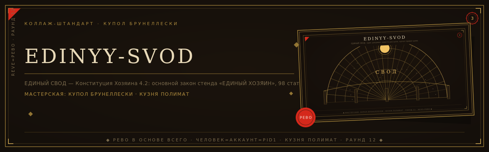
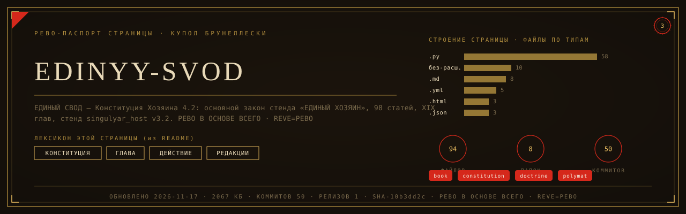

  

<!--ФОРЖ:МУЗА:НАЧАЛО-->

  
   
  

<!--ФОРЖ:МУЗА:КОНЕЦ-->

<!--ФОРЖ:ПАСПОРТ:НАЧАЛО-->

  

| ФАЙЛОВ | ПАПОК | КОММИТОВ | ОБНОВЛЕНО | РЕЛИЗОВ |
|---:|---:|---:|---|---:|
| 120 | 10 | 118 | 2026-11-19 | 1 |
<!--ФОРЖ:ПАСПОРТ:КОНЕЦ-->

# КОНСТИТУЦИЯ ХОЗЯИНА — ЕДИНЫЙ СВОД

> **Один документ вместо россыпи: купол правил дома.** Основной закон стенда «ЕДИНЫЙ ХОЗЯИН»:
> 98 статей, XIX глав, приложения А–В, журнал корректировок на 110 пунктов.
> Свод собран по методу Reve: сначала структура — главы, статьи, поруки, — потом текст.
> РЕВО в основе всего: REVE=РЕВО.

## Преамбула свода

Свод собран по методу Reve: сначала структура — главы, статьи, поруки, — потом текст.
Основной закон стенда «ЕДИНЫЙ ХОЗЯИН» держится на наименьшем отношении деятеля и
действительности и не обещает больше, чем проверяет: разрушаемая догадка, поддерживаемая
прогонами. Действующая редакция 4.2 введена в действие по статье 97 — фронтами, проверками
Х и Актом, без тихих правок канона. Ниже — первая статья и основа бытия, дословно:

> **Статья 1.** Хозяин — это деятель, способный быть автором собственных управляемых переходов, сохраняя непрерывность и не присваивая волю других деятелей. Хозяин не определяется числом доступных действий: Хозяин ≠ набор действий. Разрушительный выбор — сохранить, ограничить, уничтожить, отказаться — тоже входит в устройство и не исключается из определения.

> **Статья 3.** Основа бытия — наименьшее отношение деятеля и действительности:  **К = (Д, О, П)**

*Полный текст — в каноническом документе; свод не рецензируется в беседе, изменяется только по главе IX и статье 97.*

## Статус свода

| Положение | Значение |
|---|---|
| Действующая редакция | **4.2** — введена в действие 15.11.2026 по статье 97 («Акт ввода в действие редакции 4.2», журнал, пункт 113) |
| Предшественница | 4.1 — действовала до ввода 4.2; её итоговое положение сохранено в каноническом тексте |
| Состав поправок 4.2 | фронты III–IX: выход и отзыв · ядро и авторство · статусы и доказательность · аттестация · минимальность · история и непрерывность · запас |
| Проверки | регрессионный прогон Х-007–Х-027 и Х-030–Х-060 — **52/52 PASS** · 33 проверки частей и связей PASS · pytest 33/33 |
| Открытые вопросы | **0** — статья 70, книга закрытых вопросов |
| Стенд | `singulyar_host` v3.2 — шесть модулей институтов: revocation, status, attestation, minimality, history, reserve |

## Состав свода

| Файл | Что это |
|---|---|
| [`КОНСТИТУЦИЯ_ХОЗЯИНА_4.2.md`](КОНСТИТУЦИЯ_ХОЗЯИНА_4.2.md) | **действующая редакция 4.2** — полный канонический текст, без сокращений |
| [`АКТ_ввода_в_действие_редакции_4.2_2026-11-15.md`](АКТ_ввода_в_действие_редакции_4.2_2026-11-15.md) | явный ввод 4.2 по статье 97: решение Хозяина, условия, диффер, подписи |
| [`КОНСТИТУЦИЯ_ХОЗЯИНА_4.2-rc8.md`](КОНСТИТУЦИЯ_ХОЗЯИНА_4.2-rc8.md) | сборка машинерии фронтов III–IX: 31 опыт Х-030–Х-060, прогон 31/31, регресс 52/52 |
| [`КОНСТИТУЦИЯ_ХОЗЯИНА_4.2-rc7.md`](КОНСТИТУЦИЯ_ХОЗЯИНА_4.2-rc7.md) | рабочий кандидат (проект поправок, в действие не введён) — 98 статей без пропусков и дублей |
| [`README_АРХИВА.md`](README_АРХИВА.md) | состав архива, статусы сборок и проверок |
| [`singulyar_host/`](singulyar_host) | рабочий прототип v3.2 — машинерия институтов и исполненные опыты Х |

## Опорные статьи (дословно из канона)

| Статья | Первые положения — дословно |
|---|---|
| 1 — Хозяин | Хозяин — это деятель, способный быть автором собственных управляемых переходов, сохраняя непрерывность и не присваивая волю других деятелей. Хозяин не определяется числом доступных действий: Хозяин ≠ набор действий. |
| 62 — история и непрерывность (фронт VIII) | Узаконивание задним числом запрещено. Книга выдач прав неизменна. |
| 70 — книга закрытых вопросов (фронт IV) | Книга закрытых вопросов (фронт IV, Ф-IV-6). Открытых вопросов нет. |
| 97 — ввод в действие | Редакция 4.1 становится действующей только после: проверки всех замен; проверки совместимости старых и новых статей; проверки защищённого ядра (статья 77); выполнения необходимых регрессионных тестов; сохранения редакции 4.0; независимого свидетельства; явного ввода новой редакции в действие. До ввода в действие документ имел статус проекта поправок — рабочего кандидата 4.1-rc3. |
| 98 — минимальность и переход (фронт VII) | Введение новых способностей, механизмов, правил и проверок допускается только при доказанной необходимости. Нельзя добавлять отдельный элемент, если его роль уже выполняется существующим элементом без потери исходов, прав, ограничений и проверяемости. |

*Выдержки — начало статей, без сокращений внутри взятого отрывка; читать в главах [I](КОНСТИТУЦИЯ_ХОЗЯИНА_4.2.md), [IX](КОНСТИТУЦИЯ_ХОЗЯИНА_4.2.md), [XI](КОНСТИТУЦИЯ_ХОЗЯИНА_4.2.md), [XIX](КОНСТИТУЦИЯ_ХОЗЯИНА_4.2.md).*

## Оглавление действующей редакции

| Глава | Название |
|---|---|
| [I](КОНСТИТУЦИЯ_ХОЗЯИНА_4.2.md#глава-i-общие-положения) | Общие положения |
| [II](КОНСТИТУЦИЯ_ХОЗЯИНА_4.2.md#глава-ii-способности-и-действия) | Способности и действия |
| [III](КОНСТИТУЦИЯ_ХОЗЯИНА_4.2.md#глава-iii-семь-порук-поверхности-управления) | Семь порук поверхности управления |
| [IV](КОНСТИТУЦИЯ_ХОЗЯИНА_4.2.md#глава-iv-жизненный-путь-перехода) | Жизненный путь перехода |
| [V](КОНСТИТУЦИЯ_ХОЗЯИНА_4.2.md#глава-v-проверка-и-свидетельства) | Проверка и свидетельства |
| [VI](КОНСТИТУЦИЯ_ХОЗЯИНА_4.2.md#глава-vi-запас-ресурсов-и-необратимость) | Запас ресурсов и необратимость |
| [VII](КОНСТИТУЦИЯ_ХОЗЯИНА_4.2.md#глава-vii-непрерывность-и-ввод-в-действие) | Непрерывность и ввод в действие |
| [VIII](КОНСТИТУЦИЯ_ХОЗЯИНА_4.2.md#глава-viii-неприсвоение) | Неприсвоение |
| [IX](КОНСТИТУЦИЯ_ХОЗЯИНА_4.2.md#глава-ix-правила-о-правилах-и-изменение-основного-закона) | Правила о правилах и изменение Основного закона |
| [X](КОНСТИТУЦИЯ_ХОЗЯИНА_4.2.md#глава-x-право-отказа) | Право отказа |
| [XI](КОНСТИТУЦИЯ_ХОЗЯИНА_4.2.md#глава-xi-проверочная-система) | Проверочная система |
| [XII](КОНСТИТУЦИЯ_ХОЗЯИНА_4.2.md#глава-xii-источники-и-доказательность) | Источники и доказательность |
| [XIII](КОНСТИТУЦИЯ_ХОЗЯИНА_4.2.md#глава-xiii-что-доказано-что-гипотеза-что-закрыто) | Что доказано, что гипотеза, что закрыто |
| [XIV](КОНСТИТУЦИЯ_ХОЗЯИНА_4.2.md#глава-xiv-защищённое-ядро-и-главный-следующий-опыт) | Защищённое ядро и главный следующий опыт |
| [XV](КОНСТИТУЦИЯ_ХОЗЯИНА_4.2.md#глава-xv-основные-способности-хозяина) | Основные способности Хозяина |
| [XVI](КОНСТИТУЦИЯ_ХОЗЯИНА_4.2.md#глава-xvi-стоимость-конфликты-и-ответственность) | Стоимость, конфликты и ответственность |
| [XVII](КОНСТИТУЦИЯ_ХОЗЯИНА_4.2.md#глава-xvii-мета-хозяин-и-конституционное-управление) | Мета-Хозяин и конституционное управление |
| [XVIII](КОНСТИТУЦИЯ_ХОЗЯИНА_4.2.md#глава-xviii-проверочные-дополнения) | Проверочные дополнения |
| [XIX](КОНСТИТУЦИЯ_ХОЗЯИНА_4.2.md#глава-xix-переходные-и-заключительные-положения-редакции-41) | Переходные и заключительные положения редакции 4.1 |

Приложения: [А. Классификация 98 статей](КОНСТИТУЦИЯ_ХОЗЯИНА_4.2.md#приложение-а-классификация-98-статей-исполнимость-проверка-3) · [Б. Карточки исполнимости 52 правил](КОНСТИТУЦИЯ_ХОЗЯИНА_4.2.md#приложение-б-карточки-исполнимости-52-правил-проверка-3) · [В. Матрица перекрёстных ссылок 98 статей](КОНСТИТУЦИЯ_ХОЗЯИНА_4.2.md#приложение-в-матрица-перекрёстных-ссылок-98-статей-согласованность-проверка-1) · журнал корректировок (пункты 1–110 и ввод 4.2) · итоговое положение редакции 4.1.

## Как читать свод

1. **Сначала статус** — какая редакция действует и по какому акту (таблица выше, шапка канона).
2. **Потом структура** — девятнадцать глав: от основы бытия К=(Д,О,П) через семь порук поверхности управления к проверочной системе и защищённому ядру.
3. **Потом доказательность** — глава XIII и приложения: что доказано, что гипотеза, что закрыто; каждая статья имеет карточку исполнимости и матрицу перекрёстных ссылок.

Изменение свода — только по главе IX и статье 97: фронт поправок, рекогносцировка мировых практик, проверки Х, стенд, Акт. Никаких тихих правок канона.

<!--ФОРЖ:ПОДВАЛ-->
---

  ◆ картина и штандарт — ручная ковка <a href="https://github.com/rtynbirf">КУЗНИ ПОЛИМАТ</a> · ЧЕЛОВЕК=АККАУНТ=PID1 ◆

