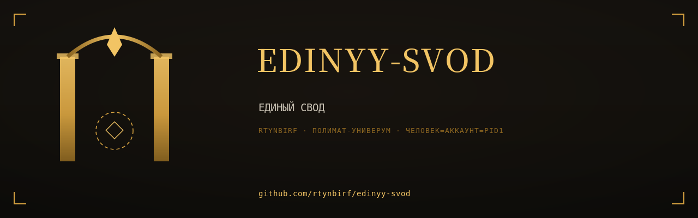
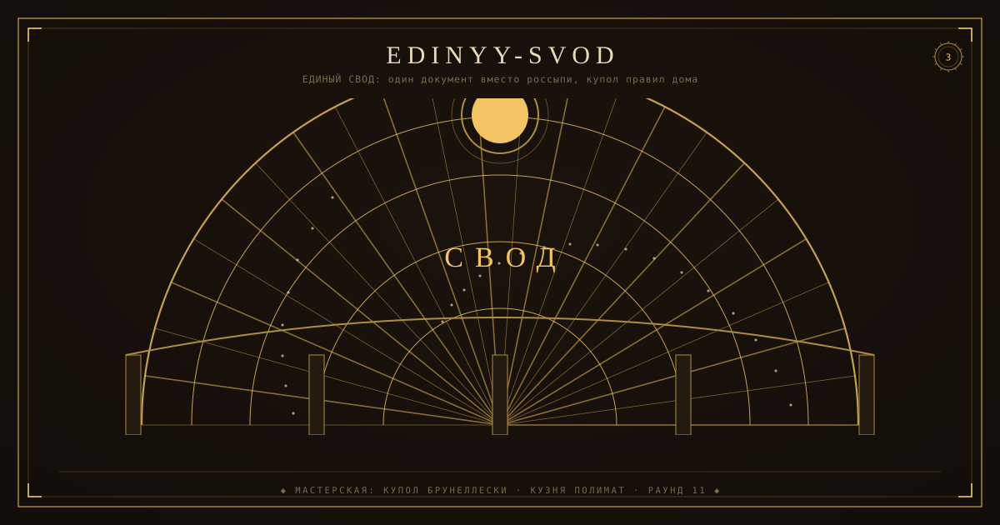

# edinyy-svod

> ЕДИНЫЙ СВОД: один документ вместо россыпи, купол правил дома

  

<!--ФОРЖ:МУЗА:НАЧАЛО-->

  
   
  

<!--ФОРЖ:МУЗА:КОНЕЦ-->

<!--ФОРЖ:ПОДВАЛ-->
---

  ◆ картина и штандарт — ручная ковка <a href="https://github.com/rtynbirf">КУЗНИ ПОЛИМАТ</a> · ЧЕЛОВЕК=АККАУНТ=PID1 ◆

